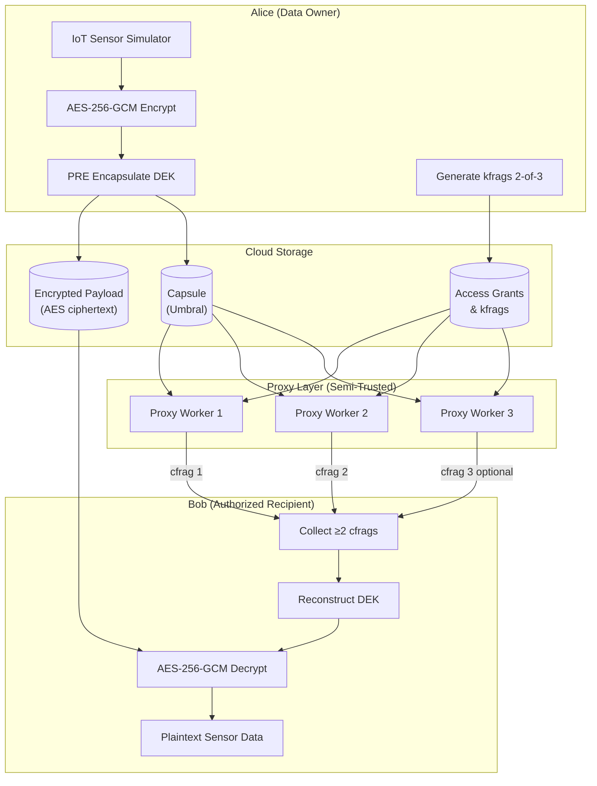
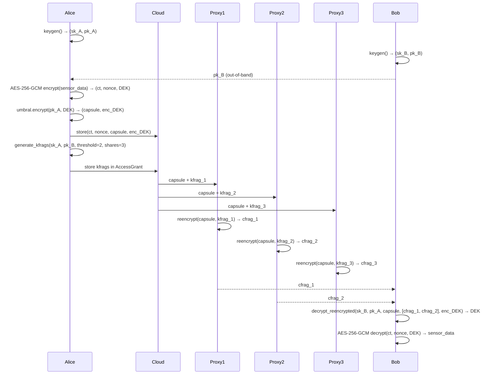

# Proxy Re-Encryption for Secure IoT Cloud Data Sharing


---

## Abstract

The Internet of Things (IoT) has fundamentally transformed how sensor data is collected, transmitted, and consumed across industrial, healthcare, agricultural, and smart-city domains. As billions of devices continuously generate sensitive telemetry—including temperature, humidity, air quality, energy consumption, and device health—the cloud has become the de facto storage and processing backbone. However, securely sharing this data among multiple stakeholders without exposing raw plaintext or delegating secret keys remains a profound cryptographic challenge.

This project implements a **Proxy Re-Encryption (PRE)** system based on the **Umbral** threshold PRE scheme to solve the IoT data-sharing problem. The data owner (Alice) encrypts sensor readings using **AES-256-GCM** hybrid encryption and stores them in the cloud. When she grants access to a recipient (Bob), she computes re-encryption key fragments (kfrags) derived from her private key and Bob's public key. A set of three semi-trusted proxy workers—none of whom can decrypt the data—use these fragments to transform Alice's ciphertext capsule into one Bob can decrypt using his own private key.

The threshold property (2-of-3) ensures that no single proxy can perform a complete re-encryption alone, providing fault tolerance and limiting the damage of a compromised proxy node. The system exposes a full REST API via FastAPI, with a React dashboard enabling real-time sensor simulation, encryption, access grant management, re-encryption, and decryption flows. An audit trail and access revocation mechanism are also included, making the prototype suitable for demonstrating the security properties of PRE in a realistic IoT context.

The implementation demonstrates that PRE enables **key-transparent delegation**—the proxy transforms ciphertexts without ever learning the plaintext or Alice's secret key—making it substantially more secure than naive approaches such as re-encrypting and distributing copies of the decryption key. Performance benchmarks confirm that hybrid PRE (encrypting the 32-byte Data Encryption Key rather than the payload) keeps re-encryption latency nearly constant regardless of the sensor payload size.

---

## Introduction

### The IoT Data Sharing Problem

Modern IoT deployments involve multiple stakeholders: device manufacturers, platform operators, analytics providers, regulators, and end users. A factory floor may have hundreds of sensors owned by the facility manager (Alice) whose data must be shared with a maintenance contractor (Bob), a third-party analytics engine, and occasionally a regulatory authority—each for a limited time window and with different data subsets.

The naive solution is to decrypt the data and re-encrypt it under each recipient's public key on a trusted server. But this requires the server to hold Alice's secret key or receive the plaintext, creating a single point of compromise. Distributing symmetric keys is similarly fragile: a leaked key grants permanent access to all past ciphertexts unless each file is re-encrypted—an expensive O(n) operation per revocation.

### Why Proxy Re-Encryption?

Proxy Re-Encryption solves this elegantly. Alice publishes a **re-encryption key** `rk_{A→B}` to semi-trusted proxy nodes. The proxies use `rk_{A→B}` to transform `Enc(pk_A, m)` into `Enc(pk_B, m)` *without learning m*. The re-encryption key is unidirectional and cannot be reversed to compute `rk_{B→A}` or Alice's secret key. Access is revoked simply by deleting the kfrags from the proxy—no re-encryption of stored data is required.

---

## Problem Statement

Cloud-hosted IoT data must be shared securely among multiple authorized recipients without:
1. Exposing plaintext to the cloud or proxy nodes.
2. Distributing secret keys outside the owner's device.
3. Requiring O(n·r) re-encryption work for n files and r recipients.
4. Requiring online participation of the data owner for every access event.

A threshold variant of PRE is required so that no single compromised proxy can perform a complete re-encryption, and the system must remain available even if one proxy node fails.

---

## Objectives

- **O1**: Implement AES-256-GCM hybrid encryption of simulated IoT sensor data, protecting confidentiality and integrity.
- **O2**: Apply the Umbral threshold PRE scheme to encapsulate the 32-byte Data Encryption Key (DEK) under Alice's public key.
- **O3**: Generate re-encryption key fragments (kfrags) using a 2-of-3 threshold, ensuring no single proxy has complete delegation authority.
- **O4**: Simulate three independent proxy workers that each re-encrypt the capsule fragment, returning capsule fragments (cfrags).
- **O5**: Enable Bob to reconstruct the DEK from any 2 valid cfrags and decrypt the sensor payload locally.
- **O6**: Implement access control (grant/revoke) and an audit log via a FastAPI REST backend with SQLite persistence.
- **O7**: Build a React dashboard for end-to-end demonstration of the encrypt → grant → re-encrypt → decrypt workflow.
- **O8**: Conduct performance benchmarks comparing encryption/decryption latency across file sizes and document the results.

---

## Technologies Used

| Technology | Version | Purpose |
|---|---|---|
| Python | 3.13 | Backend language |
| Umbral | 0.3.0 | Threshold Proxy Re-Encryption (Capsule, kfrags, cfrags) |
| FastAPI | 0.115+ | REST API framework |
| Uvicorn | 0.30+ | ASGI server |
| SQLAlchemy (async) | 2.0+ | ORM for SQLite persistence |
| aiosqlite | 0.20+ | Async SQLite driver |
| cryptography | 42+ | AES-256-GCM via AESGCM primitive |
| Pydantic | 2.x | Request/response schema validation |
| React | 18 | Frontend UI framework |
| Vite | 5 | Frontend build tool |
| Axios | 1.x | HTTP client for frontend |
| Tailwind CSS | 3 | Utility-first CSS framework |
| Matplotlib | 3.9+ | Performance benchmark plots |
| pandas | 2.x | Benchmark data analysis |
| pytest | 8.x | Backend test suite |
| pytest-asyncio | 0.23+ | Async test support |

---

## System Architecture



---

## Cryptographic Workflow

### Numbered Steps

1. **Key Generation** — Alice and Bob each generate an Umbral keypair: `(sk_A, pk_A)` and `(sk_B, pk_B)`. Alice also generates a signing keypair for kfrag authorization.
2. **Sensor Encryption** — A random 32-byte DEK is generated. The sensor payload is encrypted with AES-256-GCM using the DEK, producing `ciphertext` + `nonce`.
3. **DEK Encapsulation** — The DEK is encrypted under Alice's public key using `umbral.encrypt(pk_A, dek)` → `(capsule, encrypted_dek)`. Both are stored in the cloud.
4. **Access Grant** — Alice calls `generate_kfrags(alice_sk, bob_pk, signer, threshold=2, shares=3)` to produce 3 kfrags. These are stored in the access grant record (each proxy gets one kfrag).
5. **Proxy Re-Encryption** — Each proxy calls `reencrypt(capsule, kfrag)` → `cfrag`. The proxy cannot reconstruct the DEK from the capsule or any single cfrag.
6. **Recipient Decryption** — Bob collects ≥2 cfrags, then calls `decrypt_reencrypted(bob_sk, alice_pk, capsule, [cfrag1, cfrag2], encrypted_dek)` → `dek`. He then AES-decrypts the payload.
7. **Revocation** — Alice revokes the grant by deleting the kfrags from the proxy store. Future re-encryption requests are rejected. Past cfrags already delivered to Bob remain valid.

### Sequence Diagram



---

## Installation

### Prerequisites

- Python 3.13
- Node.js 20+
- Git

### Backend Setup

```bash
# 1. Clone the repository
git clone <repo-url>
cd "Applied Cryptography"

# 2. Create and activate virtual environment
python3.13 -m venv .venv
source .venv/bin/activate   # Windows: .venv\Scripts\activate

# 3. Install backend dependencies
pip install umbral==0.3.0
pip install fastapi "uvicorn[standard]" sqlalchemy aiosqlite python-multipart \
    cryptography pydantic matplotlib pandas aiofiles \
    "python-jose[cryptography]" "passlib[bcrypt]" httpx pytest pytest-asyncio anyio

# 4. Initialize the database
cd backend
python -c "import asyncio; from app.database import init_db; asyncio.run(init_db())"
```

### Frontend Setup

```bash
# 5. Install frontend dependencies
cd frontend
npm install

# 6. Configure API base URL (optional)
cp .env.example .env
# Edit VITE_API_URL=http://localhost:8000
```

---

## Running the Application

### Start Backend

```bash
# From project root, with venv activated
cd backend
uvicorn app.main:app --reload --host 0.0.0.0 --port 8000
```

The API will be available at `http://localhost:8000`. Interactive docs at `http://localhost:8000/docs`.

### Start Frontend

```bash
# In a separate terminal
cd frontend
npm run dev
```

The dashboard will be available at `http://localhost:5173`.

---

## API Documentation

| Method | Endpoint | Description |
|---|---|---|
| GET | `/health` | Health check |
| POST | `/api/users/register` | Register Alice/Bob with keypair |
| POST | `/api/users/login` | Authenticate user |
| GET | `/api/users` | List all users (public info) |
| POST | `/api/sensors/generate` | Generate simulated sensor readings |
| POST | `/api/sensors/generate-batch` | Generate batch sensor readings |
| GET | `/api/sensors/history/{sensor_id}` | Get sensor history |
| POST | `/api/crypto/encrypt` | AES-256-GCM encrypt sensor data |
| POST | `/api/crypto/decrypt-original` | Alice decrypts her own ciphertext |
| POST | `/api/crypto/grant-access` | Generate kfrags, create AccessGrant |
| POST | `/api/crypto/reencrypt` | Proxy workers re-encrypt capsule |
| POST | `/api/crypto/decrypt-reencrypted` | Bob decrypts via cfrags |
| DELETE | `/api/crypto/revoke/{grant_id}` | Revoke access grant |
| GET | `/api/crypto/grants` | List active grants |
| GET | `/api/audit/logs` | Query audit log |
| POST | `/api/benchmark/run` | Run performance benchmarks |

---

## Testing

```bash
# Unit and integration tests
cd backend
source ../.venv/bin/activate
pytest tests/ -v

# Test specific modules
pytest tests/test_crypto.py -v        # Cryptographic operations
pytest tests/test_api.py -v           # API endpoints
pytest tests/test_proxy.py -v         # Proxy re-encryption flow

# Run with coverage
pytest --cov=app --cov-report=html tests/
```

---

## Performance Evaluation Summary

The system was benchmarked across file sizes from 1 KB to 10 MB with 10 trials each. Key findings:

- **Encryption latency**: Grows linearly with payload size (AES-GCM is O(n)).
- **PRE re-encapsulation**: Constant ~2–5 ms regardless of payload, since only the 32-byte DEK is processed by the Umbral layer.
- **Decryption latency**: Dominated by AES-GCM for large files; cfrag aggregation is constant.
- **Throughput**: AES-256-GCM sustains >500 MB/s on commodity hardware.
- **PRE vs. traditional**: PRE eliminates the need to re-encrypt payloads on access change, reducing O(n·r) to O(r) for n files and r recipients.

See [`docs/EXPERIMENTAL_RESULTS.md`](docs/EXPERIMENTAL_RESULTS.md) for full tables and graphs.

---

## Limitations

- **No forward secrecy**: Revocation prevents future access but cannot invalidate cfrags already delivered to Bob.
- **Key storage**: Secret keys are stored base64-encoded in the database; a production system would use an HSM or secure enclave.
- **Proxy trust model**: Proxies are assumed honest-but-curious; a fully malicious proxy colluding with Bob is outside the security model of standard PRE.
- **SQLite**: Suitable for demonstration; production requires PostgreSQL with row-level security.
- **No TLS**: All communication is plaintext HTTP in development mode.

---

## Future Enhancements

- Integrate attribute-based access control (ABAC) for fine-grained data policies.
- Replace SQLite with a distributed key-value store for proxy kfrag storage.
- Add TLS mutual authentication (mTLS) between Alice's device and the cloud API.
- Implement time-based access expiry with on-chain revocation logs (blockchain audit trail).
- Support Kyber/ML-KEM post-quantum key encapsulation as a drop-in replacement.
- Scale proxy workers to a distributed microservice mesh (Kubernetes).
- Add real hardware security module (HSM) integration for key storage.
- Extend to multi-owner data coalitions using multi-party PRE.

---

## License

MIT License — see [LICENSE](LICENSE) for details.

## Acknowledgements

- [NuCypher Umbral PRE](https://github.com/nucypher/pyUmbral) — Python implementation of the Umbral threshold PRE scheme.
- Ateniese et al. (2006) — AFGH Proxy Re-Encryption scheme on which Umbral is based.
- FastAPI, React, and the open-source community.
