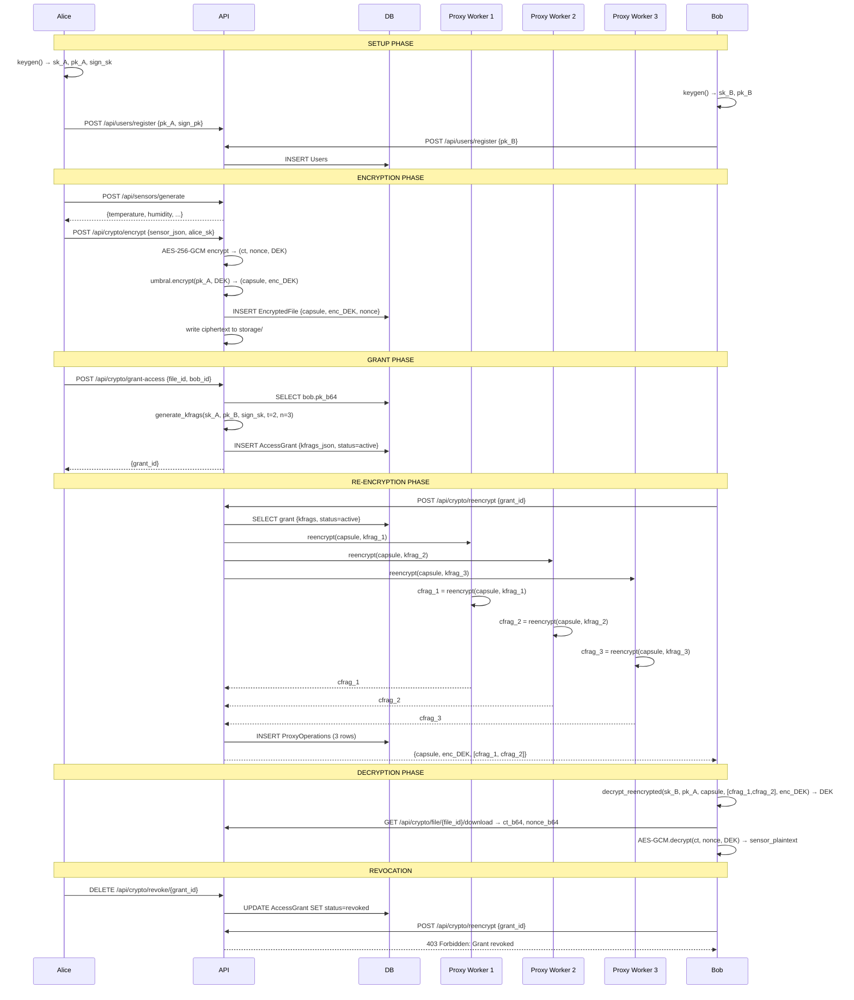

# Cryptographic Workflow

## Overview

This document describes each cryptographic operation in the PRE-IoT system, including code examples drawn directly from the implementation, mathematical descriptions, and a full sequence diagram.

---

## 1. Key Generation Workflow

Every participant (Alice, Bob) generates an independent Umbral keypair. Alice additionally generates a signing keypair to authenticate kfrags.

### Code

```python
from umbral import SecretKey, Signer
import base64

def generate_keypair() -> dict:
    """Generate an Umbral keypair. Returns base64-encoded secret and public keys."""
    sk = SecretKey.random()
    pk = sk.public_key()
    return {
        "secret_key_b64": base64.b64encode(bytes(sk)).decode(),
        "public_key_b64": base64.b64encode(bytes(pk)).decode(),
    }

def generate_signing_keypair() -> dict:
    """Generate a signing keypair for kfrag authentication."""
    signing_sk = SecretKey.random()
    signing_pk = signing_sk.public_key()
    return {
        "signing_sk_b64": base64.b64encode(bytes(signing_sk)).decode(),
        "signing_pk_b64": base64.b64encode(bytes(signing_pk)).decode(),
    }
```

### Mathematical Description

Umbral operates on an elliptic curve group `G` of prime order `q` with generator `g`. Each keypair is:
- **Secret key**: `sk ∈ Z_q` (a random scalar)
- **Public key**: `pk = g^sk ∈ G` (a group element)
- **Signing key**: An independent keypair for ECDSA signature generation

---

## 2. AES-256-GCM Data Encryption

IoT sensor payloads are encrypted using AES-256-GCM. A fresh random DEK and nonce are generated for every file.

### Code

```python
import os
import base64
from cryptography.hazmat.primitives.ciphers.aead import AESGCM

def encrypt_data(plaintext: bytes) -> dict:
    """
    Encrypt plaintext with AES-256-GCM.
    Returns base64-encoded ciphertext, nonce, and DEK.
    NEVER log dek or plaintext.
    """
    dek = os.urandom(32)       # 256-bit Data Encryption Key
    nonce = os.urandom(12)     # 96-bit nonce (NIST recommended for GCM)
    aesgcm = AESGCM(dek)
    # ciphertext includes 16-byte authentication tag appended by AESGCM
    ciphertext = aesgcm.encrypt(nonce, plaintext, None)
    return {
        "ciphertext_b64": base64.b64encode(ciphertext).decode(),
        "nonce_b64": base64.b64encode(nonce).decode(),
        "dek_b64": base64.b64encode(dek).decode(),
    }

def decrypt_data(ciphertext_b64: str, nonce_b64: str, dek_b64: str) -> bytes:
    """
    Decrypt AES-256-GCM ciphertext.
    Raises cryptography.exceptions.InvalidTag if authentication fails.
    """
    dek = base64.b64decode(dek_b64)
    nonce = base64.b64decode(nonce_b64)
    ciphertext = base64.b64decode(ciphertext_b64)
    aesgcm = AESGCM(dek)
    return aesgcm.decrypt(nonce, ciphertext, None)
```

### Properties

| Property | Value |
|---|---|
| Algorithm | AES-256-GCM |
| Key size | 256 bits (32 bytes) |
| Nonce size | 96 bits (12 bytes), random per file |
| Authentication tag | 128 bits (16 bytes), appended to ciphertext |
| Security level | 128-bit equivalent (birthday bound) |
| Failure mode | `InvalidTag` exception if any byte is modified |

---

## 3. PRE Encapsulation of DEK

After AES encryption, the DEK is encapsulated under Alice's public key using Umbral's ECIES-based encrypt function. The result is a **capsule** (compressed ECDH share) and **encrypted DEK** (the DEK ciphertext under `pk_A`).

### Code

```python
from umbral import SecretKey, PublicKey, encrypt as umbral_encrypt, decrypt_original
import base64

def pre_encapsulate_dek(dek_bytes: bytes, alice_pk_b64: str) -> dict:
    """
    Encapsulate the DEK under Alice's public key using Umbral PRE.
    Returns base64-encoded capsule and encrypted DEK.
    """
    alice_pk = PublicKey.from_bytes(base64.b64decode(alice_pk_b64))
    capsule, encrypted_dek = umbral_encrypt(alice_pk, dek_bytes)
    return {
        "capsule_b64": base64.b64encode(bytes(capsule)).decode(),
        "encrypted_dek_b64": base64.b64encode(encrypted_dek).decode(),
    }

def pre_decrypt_original_dek(alice_sk_b64: str, capsule_b64: str,
                              encrypted_dek_b64: str) -> bytes:
    """Alice decrypts her own DEK (without proxy re-encryption)."""
    from umbral import Capsule
    alice_sk = SecretKey.from_bytes(base64.b64decode(alice_sk_b64))
    capsule = Capsule.from_bytes(base64.b64decode(capsule_b64))
    encrypted_dek = base64.b64decode(encrypted_dek_b64)
    return decrypt_original(alice_sk, capsule, encrypted_dek)
```

### Mathematical Description

**Umbral encrypt(pk_A, m)**:
1. Sample random scalar `r ∈ Z_q`.
2. Compute ephemeral key: `E = pk_A^r = g^{sk_A · r}`.
3. Compute capsule point: `V = g^r`.
4. Derive symmetric key: `K = KDF(E)`.
5. Encrypt message: `c = AES(K, m)` (Umbral uses XSalsa20 internally for the DEK).
6. Compute commitment: `s = r + H(E, V) · sk_A` (mod q).
7. Return: **Capsule** `C = (E, V, s)` and **ciphertext** `c`.

---

## 4. kfrag Generation (2-of-3 Threshold)

Alice generates 3 key re-encryption fragments. Any 2 are sufficient to re-encrypt the capsule. Each kfrag is signed by Alice's signing key.

### Code

```python
from umbral import SecretKey, PublicKey, Signer, generate_kfrags
import base64

def generate_kfrags_for_sharing(
    alice_sk_b64: str,
    alice_signing_sk_b64: str,
    bob_pk_b64: str,
    threshold: int = 2,
    shares: int = 3
) -> list[str]:
    """
    Generate re-encryption key fragments for delegating from Alice to Bob.
    Returns list of base64-encoded kfrags.
    """
    alice_sk = SecretKey.from_bytes(base64.b64decode(alice_sk_b64))
    alice_signing_sk = SecretKey.from_bytes(base64.b64decode(alice_signing_sk_b64))
    bob_pk = PublicKey.from_bytes(base64.b64decode(bob_pk_b64))
    signer = Signer(alice_signing_sk)

    kfrags = generate_kfrags(
        delegating_sk=alice_sk,
        receiving_pk=bob_pk,
        signer=signer,
        threshold=threshold,
        shares=shares
    )
    return [base64.b64encode(bytes(kf)).decode() for kf in kfrags]
```

### Mathematical Description (Shamir-based splitting)

The re-encryption key `rk_{A→B}` is conceptually `sk_A^{-1} · sk_B` (over the pairing group). Umbral splits this using a `(t, n)` Shamir secret sharing scheme:

1. Choose a random polynomial `f(x) = rk_{A→B} + a_1·x + ... + a_{t-1}·x^{t-1}` over `Z_q`.
2. Evaluate at `n` distinct points: `kfrag_i = f(x_i)` for `i = 1..n`.
3. Any `t` evaluations suffice to reconstruct `f(0) = rk_{A→B}` via Lagrange interpolation.
4. Each kfrag is signed: `sig_i = ECDSA(alice_signing_sk, kfrag_i)`.

---

## 5. Proxy Re-Encryption

Each proxy worker independently applies its kfrag to the capsule to produce a capsule fragment (cfrag).

### Code

```python
from umbral import Capsule, VerifiedKeyFrag, reencrypt
import base64

def proxy_reencrypt_capsule(capsule_b64: str, kfrag_b64: str) -> str:
    """
    Proxy re-encrypts a capsule using its key fragment.
    Returns base64-encoded capsule fragment (cfrag).
    In umbral 0.3.0, reencrypt() returns VerifiedCapsuleFrag directly.
    """
    capsule = Capsule.from_bytes(base64.b64decode(capsule_b64))
    # VerifiedKeyFrag.from_bytes performs signature verification implicitly
    kfrag = VerifiedKeyFrag.from_bytes(base64.b64decode(kfrag_b64))
    cfrag = reencrypt(capsule, kfrag)
    return base64.b64encode(bytes(cfrag)).decode()
```

### Mathematical Description

For kfrag `kf_i` (a share of `rk_{A→B}`), the proxy computes:
```
cfrag_i = (E · kf_i, proof_i)
```
where `E = pk_A^r` is the ephemeral key point in the capsule, and `proof_i` is a zero-knowledge correctness proof that the proxy applied `kf_i` faithfully without knowing `sk_A` or the plaintext.

> [!NOTE] The proxy sees only `(E, V, s)` from the capsule. It cannot derive `E` without `sk_A` (discrete log hardness), and it cannot derive the symmetric key `K = KDF(E)` from `V = g^r` alone. The re-encryption transforms the capsule point using the kfrag, but the resulting cfrag is only useful in combination with ≥ t-1 other cfrags and Bob's secret key.

---

## 6. Recipient Decryption (Bob)

Bob collects any 2 cfrags and uses his secret key to reconstruct the DEK.

### Code

```python
from umbral import (
    SecretKey, PublicKey, Capsule,
    VerifiedCapsuleFrag, decrypt_reencrypted
)
from cryptography.hazmat.primitives.ciphers.aead import AESGCM
import base64

def decrypt_reencrypted_dek(
    bob_sk_b64: str,
    alice_pk_b64: str,
    capsule_b64: str,
    cfrag_b64_list: list[str],
    encrypted_dek_b64: str
) -> bytes:
    """
    Bob decrypts the DEK using cfrags from ≥2 proxy workers.
    Returns raw DEK bytes.
    """
    bob_sk = SecretKey.from_bytes(base64.b64decode(bob_sk_b64))
    alice_pk = PublicKey.from_bytes(base64.b64decode(alice_pk_b64))
    capsule = Capsule.from_bytes(base64.b64decode(capsule_b64))
    encrypted_dek = base64.b64decode(encrypted_dek_b64)

    verified_cfrags = [
        VerifiedCapsuleFrag.from_bytes(base64.b64decode(cf))
        for cf in cfrag_b64_list
    ]

    dek = decrypt_reencrypted(
        receiving_sk=bob_sk,
        delegating_pk=alice_pk,
        capsule=capsule,
        verified_cfrags=verified_cfrags,
        ciphertext=encrypted_dek
    )
    return dek

def bob_decrypt_payload(ciphertext_b64: str, nonce_b64: str, dek: bytes) -> bytes:
    """AES-256-GCM decrypt the sensor payload with the reconstructed DEK."""
    nonce = base64.b64decode(nonce_b64)
    ciphertext = base64.b64decode(ciphertext_b64)
    aesgcm = AESGCM(dek)
    return aesgcm.decrypt(nonce, ciphertext, None)
```

### Mathematical Description

Bob uses the ≥t cfrags and his secret key to reconstruct the re-encrypted capsule point:

1. Lagrange interpolate the cfrag points to recover the re-encrypted point `E' = E · rk_{A→B}`.
2. Compute: `K' = KDF(E'^{sk_B}) = KDF(E^{sk_A^{-1} · sk_B · sk_B^{-1}...)`  
   (The math simplifies through the pairing to yield the same symmetric key `K` Alice used.)
3. Decrypt: `m = AES-decrypt(K', encrypted_dek)` → original DEK.

---

## 7. Full Sequence Diagram



---

## 8. Mathematical Summary of Umbral PRE Scheme

**Setup**: Elliptic curve group `(G, q, g)`. Hash functions `H: G → Z_q`, `KDF: G → {0,1}^256`.

**KeyGen()**:
- `sk ← Z_q^*`
- `pk = g^sk`

**Encrypt(pk_A, m)**:
- `r ← Z_q^*`
- `E = pk_A^r`, `V = g^r`
- `s = r + H(E,V)·sk_A` (note: for verification)
- `K = KDF(E)`
- `c = Enc_K(m)`
- Return `(C = (E, V, s), c)`

**KeyFrag(sk_A, pk_B, t, n)**:
- `d = H(pk_B, pk_B^{sk_A})`
- `f(x) = sk_A · d^{-1} + a_1·x + ... + a_{t-1}·x^{t-1}` (over Z_q)
- `kfrag_i = (x_i, f(x_i), commitment, proof, sig_{Alice})`

**ReEncrypt(C, kfrag_i)**:
- `cfrag_i = (E · g^{f(x_i)}, x_i, proof_i, commitment_i)`

**Decrypt(sk_B, pk_A, C, {cfrag_i}_{i∈S})**:
- Lagrange: `E' = ∏_{i∈S} cfrag_i.E_part^{λ_i}` (Lagrange coefficients λ_i)
- `K = KDF( (E')^{sk_B} )`
- `m = Dec_K(c)`

---

## 9. Serialization Format

All cryptographic objects are serialized using Umbral's built-in `bytes()` method and transported as base64-encoded strings in JSON.

| Object | Serialization | Typical Size |
|---|---|---|
| `SecretKey` | `bytes(sk)` → 32 bytes → 44 chars b64 | 44 chars |
| `PublicKey` | `bytes(pk)` → 33 bytes (compressed EC point) → 44 chars | 44 chars |
| `Capsule` | `bytes(capsule)` → ~98 bytes → 132 chars | 132 chars |
| `VerifiedKeyFrag` | `bytes(kfrag)` → ~194 bytes → 260 chars | 260 chars |
| `VerifiedCapsuleFrag` | `bytes(cfrag)` → ~131 bytes → 176 chars | 176 chars |
| AES ciphertext | raw bytes → variable + 16-byte tag | payload + 16 bytes |
| Nonce | 12 bytes → 16 chars b64 | 16 chars |

**Deserialization**:
```python
from umbral import SecretKey, PublicKey, Capsule, VerifiedKeyFrag, VerifiedCapsuleFrag
import base64

sk = SecretKey.from_bytes(base64.b64decode(sk_b64))
pk = PublicKey.from_bytes(base64.b64decode(pk_b64))
capsule = Capsule.from_bytes(base64.b64decode(capsule_b64))
kfrag = VerifiedKeyFrag.from_bytes(base64.b64decode(kfrag_b64))
cfrag = VerifiedCapsuleFrag.from_bytes(base64.b64decode(cfrag_b64))
```

> [!WARNING] `VerifiedKeyFrag.from_bytes()` bypasses signature re-verification. In the prototype this is acceptable because kfrags are stored in the trusted database. In production, proxies should use `KeyFrag.from_bytes(...).verify(alice_verifying_pk, alice_pk, bob_pk)` to cryptographically confirm the kfrag was generated by Alice and is intended for Bob before applying it.
