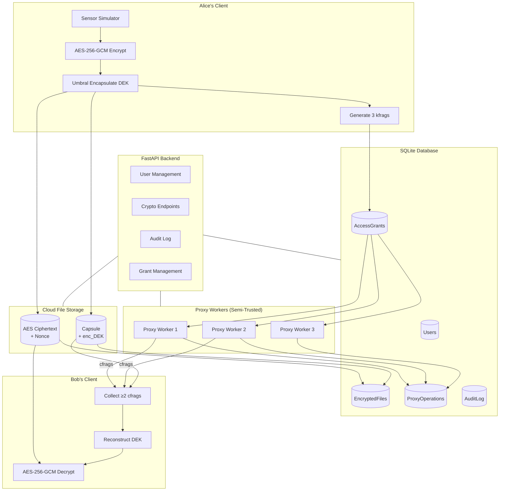

# Proxy Re-Encryption for Secure IoT Cloud Data Sharing — Project Report

**Course**: Applied Cryptography  
**Academic Year**: 2024–2025  
**Technology Stack**: Python 3.13 · Umbral 0.3.0 · FastAPI · React 18  

---

## Abstract

The proliferation of Internet of Things (IoT) devices has created an unprecedented volume of sensitive operational data that must be securely stored in cloud infrastructure and selectively shared among authorized stakeholders. Traditional encryption approaches require the data owner to either decrypt and re-encrypt data for each new recipient—exposing plaintext on a trusted server—or distribute secret keys, violating the principle of least privilege.

This report presents the design, implementation, and evaluation of a **threshold Proxy Re-Encryption (PRE) system** for secure IoT cloud data sharing. The system employs the **Umbral** AFGH-based PRE scheme with a 2-of-3 threshold to delegate decryption rights from a data owner (Alice) to authorized recipients (Bob) through a set of semi-trusted proxy nodes, without ever exposing the plaintext or Alice's private key to the proxies. IoT sensor data is protected with **AES-256-GCM** hybrid encryption; only the 32-byte Data Encryption Key (DEK) is processed by the PRE layer, keeping re-encryption latency constant regardless of payload size.

The implementation comprises a FastAPI backend with asynchronous SQLite persistence, a React-based dashboard for end-to-end workflow demonstration, an audit log, access revocation, and three simulated proxy worker nodes. Performance benchmarks across payload sizes from 1 KB to 10 MB confirm that the PRE overhead is negligible, validating the hybrid design. A comprehensive threat model analysis demonstrates that the system resists eavesdropping, unauthorized access, and single-proxy compromise, while acknowledging the inherent absence of forward secrecy on delivered capsule fragments.

---

## 1. Introduction

### 1.1 Motivation

IoT ecosystems are characterized by resource-constrained devices generating high-velocity telemetry streams. A smart factory may deploy thousands of vibration, temperature, and energy sensors whose readings are continuously uploaded to a cloud platform. Access to this data must be managed dynamically: a maintenance contractor requires access during their service window, a regulatory auditor needs periodic data exports, and a machine-learning pipeline requires a continuous data feed—each with different access lifetimes and scopes.

Conventional approaches to this problem are:

1. **Symmetric key distribution**: Share the AES key with each authorized party. Any key compromise exposes all past and future ciphertexts encrypted under that key. Revocation requires re-keying and re-encrypting the entire dataset.
2. **Re-encrypt on a trusted server**: Decrypt on a server and re-encrypt under the recipient's public key. The server must hold Alice's private key, creating a catastrophic single point of failure.
3. **Public key encryption per recipient**: Encrypt a separate copy under each recipient's public key. Storage and management costs grow as O(n·r).

None of these approaches is satisfactory for a large-scale, dynamically-managed IoT deployment. Proxy Re-Encryption provides a cryptographically rigorous solution.

### 1.2 Contribution

This project contributes a working prototype that:
- Demonstrates end-to-end PRE for IoT sensor data using the Umbral library.
- Implements threshold (2-of-3) re-encryption through three simulated proxy workers.
- Provides a production-structured FastAPI REST API and React dashboard.
- Includes a detailed performance evaluation, threat model, and academic documentation.

---

## 2. Background

### 2.1 Symmetric Encryption

Symmetric encryption uses the same key for encryption and decryption. The Advanced Encryption Standard (AES) in Galois/Counter Mode (GCM) is the industry standard for authenticated encryption with associated data (AEAD). AES-256-GCM provides 256-bit confidentiality and 128-bit authentication tag integrity in a single pass. Its performance exceeds 500 MB/s on hardware with AES-NI acceleration, making it ideal for encrypting IoT payload data.

**Construction**: Given a 256-bit key `k`, a 96-bit nonce `N`, plaintext `P`, and optional associated data `A`:
```
(C, T) = AES-256-GCM.Encrypt(k, N, P, A)
```
where `C` is the ciphertext, `T` is the 128-bit authentication tag. Decryption fails if `T` does not verify, detecting any tampering.

### 2.2 Asymmetric Encryption

Asymmetric (public key) encryption uses a mathematically linked keypair: encrypting under the public key `pk` produces a ciphertext only decryptable with the corresponding secret key `sk`. RSA-OAEP and elliptic curve integrated encryption scheme (ECIES) are common constructions. Umbral operates on elliptic curves (specifically the secp256k1 / BN256 families), providing compact keys and efficient scalar multiplication.

### 2.3 Hybrid Encryption

Hybrid encryption combines the speed of symmetric encryption with the key management advantages of asymmetric encryption. A random symmetric key (the DEK) is generated per message, the message is encrypted under the DEK, and the DEK itself is encrypted (encapsulated) under the recipient's public key. Only the DEK ciphertext needs asymmetric processing, keeping overall latency proportional to symmetric encryption speed.

### 2.4 Proxy Re-Encryption Theory

**Definition (Blaze, Bleumer, Strauss 1998)**: A PRE scheme allows a proxy, holding a re-encryption key `rk_{A→B}`, to transform ciphertexts encrypted under Alice's public key into ciphertexts decryptable by Bob's secret key, *without learning the plaintext*.

Key security properties of a PRE scheme:
- **Non-transitivity**: `rk_{A→B}` cannot be composed with `rk_{B→C}` to produce `rk_{A→C}`.
- **Collusion safety** (single-hop): `rk_{A→B}` and `sk_B` together do not reveal `sk_A`.
- **Proxy invisibility**: The proxy sees only the capsule (a compressed ECIES ephemeral share), not the plaintext.
- **Unidirectionality**: `rk_{A→B}` cannot be used to compute `rk_{B→A}`.

### 2.5 The AFGH PRE Scheme

Ateniese, Fu, Green, and Hohenberger (2006) introduced a CCA-secure unidirectional PRE scheme on bilinear pairings. The re-encryption key is `rk_{A→B} = sk_A^{-1} · sk_B` (in the exponent over the pairing group), enabling the proxy to transform `Enc(pk_A, m) = (g^r, m · e(g,g)^{r·sk_A})` into `(g^r, m · e(g,g)^{r·sk_B})` using only `rk_{A→B}`.

### 2.6 Umbral: Threshold PRE

Umbral (Nuñez, Agudo, Lopez 2017) extends the AFGH scheme with a threshold secret-sharing mechanism. The re-encryption key `rk_{A→B}` is split into `n` key fragments (kfrags) using Shamir's Secret Sharing, such that any `t` of `n` fragments suffice to re-encrypt a capsule. Each proxy holds one kfrag and produces one capsule fragment (cfrag). The recipient combines ≥ `t` cfrags to reconstruct the re-encrypted DEK.

**Capsule structure**: `C = (E, V, s)` where `E = pk_A^r`, `V = g^r`, `s` is a point commitment. The re-encryption of a capsule with kfrag `kf_i` produces `cfrag_i = (E · kf_i, proof_i)`.

---

## 3. Problem Statement

**Given**: An IoT cloud platform where sensor data is encrypted by Alice and stored. Multiple authorized recipients need read access, with the ability to grant and revoke access dynamically.

**Constraints**:
1. The cloud provider (proxy) must never learn the plaintext.
2. Alice must not need to be online for every access event after granting.
3. Revocation must not require re-encrypting stored ciphertexts.
4. No single proxy node should have the ability to perform complete re-encryption alone (threshold requirement).

**Goal**: Design and implement a threshold PRE system satisfying all four constraints, with an API and UI suitable for demonstration and practical evaluation.

---

## 4. Proposed System

The proposed system uses a hybrid PRE architecture:

1. **Data layer**: AES-256-GCM encrypts the IoT sensor payload. The DEK is random and unique per upload.
2. **Key encapsulation layer**: The DEK is encapsulated under Alice's Umbral public key. The capsule and encrypted DEK are stored alongside the ciphertext.
3. **Delegation layer**: Alice generates 3 kfrags (threshold 2). Each is delivered to a separate proxy worker. No proxy sees another's kfrag.
4. **Re-encryption layer**: Each proxy independently applies `reencrypt(capsule, kfrag_i)` → `cfrag_i`. Bob collects any 2 cfrags.
5. **Decryption layer**: Bob calls `decrypt_reencrypted(sk_B, pk_A, capsule, [cfrag1, cfrag2], enc_DEK)` → DEK, then AES-decrypts the payload.

---

## 5. System Architecture



### 5.1 Component Descriptions

| Component | Role |
|---|---|
| Alice's Client | Sensor owner; performs all encryption and kfrag generation |
| FastAPI Backend | Stateless REST API; orchestrates crypto calls, persists metadata |
| SQLite Database | Stores user records, file metadata, grants, proxy operations, audit log |
| Cloud File Storage | Stores AES ciphertexts and Umbral capsules (base64 encoded) |
| Proxy Workers | Three independent workers that perform re-encryption; no worker sees another's kfrag |
| Bob's Client | Authorized recipient; collects cfrags and performs final decryption |

---

## 6. Cryptographic Design

### 6.1 Key Generation

Each user generates an Umbral keypair and a signing keypair:

```python
from umbral import SecretKey, Signer

alice_sk = SecretKey.random()
alice_pk = alice_sk.public_key()
alice_signing_sk = SecretKey.random()
alice_signer = Signer(alice_signing_sk)
```

Keys are serialized to bytes and stored as base64 strings:
```python
import base64
sk_b64 = base64.b64encode(bytes(alice_sk)).decode()
```

### 6.2 AES-256-GCM Data Encryption

```python
import os
from cryptography.hazmat.primitives.ciphers.aead import AESGCM

dek = os.urandom(32)       # 256-bit Data Encryption Key
nonce = os.urandom(12)     # 96-bit nonce
aesgcm = AESGCM(dek)
ciphertext = aesgcm.encrypt(nonce, plaintext_bytes, None)
# ciphertext includes 16-byte authentication tag appended by AESGCM
```

Decryption automatically verifies the authentication tag; raises `InvalidTag` on failure.

### 6.3 PRE Encapsulation (Umbral)

The DEK is encapsulated under Alice's public key using Umbral's symmetric encryption primitive:

```python
from umbral import encrypt

capsule, encrypted_dek = encrypt(alice_pk, dek)
```

Here `encrypted_dek` is the DEK encrypted under `alice_pk` via ECIES, and `capsule` is the compressed ephemeral key material needed for re-encryption.

### 6.4 Threshold Re-encryption Key Fragment Generation (2-of-3)

```python
from umbral import generate_kfrags

kfrags = generate_kfrags(
    delegating_sk=alice_sk,
    receiving_pk=bob_pk,
    signer=alice_signer,
    threshold=2,
    shares=3
)
# Returns 3 VerifiedKeyFrag objects
```

Each kfrag contains Alice's partial re-encryption key share, signed by Alice's signing key so proxies can verify authenticity.

### 6.5 Proxy Re-Encryption

Each proxy independently re-encrypts the capsule using its kfrag:

```python
from umbral import reencrypt

cfrag = reencrypt(capsule, kfrag)
# Returns VerifiedCapsuleFrag directly (no separate verify() call needed in umbral 0.3.0)
```

The proxy cannot reconstruct the DEK from the capsule alone, or from fewer than `threshold` cfrags.

### 6.6 Recipient Decryption

Bob collects any 2 valid cfrags and decrypts:

```python
from umbral import decrypt_reencrypted

dek = decrypt_reencrypted(
    receiving_sk=bob_sk,
    delegating_pk=alice_pk,
    capsule=capsule,
    verified_cfrags=[cfrag1, cfrag2],
    ciphertext=encrypted_dek
)
# dek is the original 32-byte DEK
# Bob then uses dek to AES-decrypt the payload
aesgcm = AESGCM(dek)
plaintext = aesgcm.decrypt(nonce, ciphertext, None)
```

### 6.7 Access Control and Revocation

Access grants are stored in the database with status `active`, `revoked`, or `expired`. Revocation sets the grant status to `revoked` and deletes the kfrags from the proxy workers' accessible store. The access control flow:

1. Alice POSTs to `/api/crypto/grant-access` with `file_id` and `grantee_id` → kfrags generated and stored.
2. Bob calls `/api/crypto/reencrypt` → proxy workers fetch kfrags from active grants only.
3. Alice calls `DELETE /api/crypto/revoke/{grant_id}` → grant status set to `revoked`.
4. Subsequent re-encryption attempts return 403 Forbidden.

> [!NOTE] Revocation is prospective only. Cfrags already delivered to Bob before revocation remain usable, since they are computed values, not stored secrets the system controls.

---

## 7. Implementation

### 7.1 Project Structure

```
Applied Cryptography/
├── backend/
│   ├── app/
│   │   ├── main.py                 # FastAPI app, middleware, router registration
│   │   ├── database.py             # Async SQLAlchemy engine, session factory
│   │   ├── models.py               # ORM models
│   │   ├── crypto/
│   │   │   ├── aes_encryption.py   # AES-256-GCM helpers
│   │   │   └── umbral_pre.py       # Umbral PRE helpers
│   │   ├── services/
│   │   │   ├── sensor_simulator.py # IoT sensor data generation
│   │   │   └── proxy_service.py    # Three-worker re-encryption orchestration
│   │   └── routers/
│   │       ├── users.py
│   │       ├── sensors.py
│   │       ├── crypto.py
│   │       ├── audit.py
│   │       └── benchmark.py
│   └── tests/
│       ├── test_crypto.py
│       ├── test_api.py
│       └── test_proxy.py
├── frontend/
│   ├── src/
│   │   ├── App.jsx
│   │   ├── components/
│   │   │   ├── Dashboard.jsx
│   │   │   ├── SensorPanel.jsx
│   │   │   ├── EncryptionPanel.jsx
│   │   │   ├── AccessGrantPanel.jsx
│   │   │   ├── ProxyPanel.jsx
│   │   │   └── DecryptionPanel.jsx
│   │   └── api/
│   │       └── client.js
│   └── package.json
├── docs/
│   ├── PROJECT_REPORT.md
│   ├── SYSTEM_ARCHITECTURE.md
│   ├── CRYPTOGRAPHIC_WORKFLOW.md
│   ├── THREAT_MODEL.md
│   ├── EXPERIMENTAL_RESULTS.md
│   ├── VIVA_QUESTIONS.md
│   └── DEMONSTRATION_GUIDE.md
├── README.md
└── .gitignore
```

### 7.2 Key Implementation Decisions

**Base64 serialization**: All cryptographic objects (keys, capsules, kfrags, cfrags) are serialized with `bytes(obj)` and stored base64-encoded for JSON compatibility. Deserialization uses `Type.from_bytes(b64decode(s))`.

**Async database**: SQLAlchemy 2.0 with aiosqlite provides non-blocking database I/O, allowing the FastAPI event loop to handle concurrent requests without thread-pool overhead.

**Proxy worker simulation**: Three functions within `proxy_service.py` simulate independent proxy workers. Each records its operation (worker_id, processing_time_ms, status) in the `ProxyOperation` table, enabling audit of which workers participated in each re-encryption event.

**Sensor simulator**: Generates realistic IoT readings with temporal drift (temperature follows a sinusoidal day/night cycle, air quality degrades linearly over a shift). Data is JSON-serialized before AES encryption.

---

## 8. Security Analysis

### 8.1 Confidentiality

AES-256-GCM provides IND-CPA security under the standard assumption that AES is a pseudorandom permutation. The 256-bit key provides 128 bits of security against exhaustive search (accounting for the birthday bound). Random nonces (12 bytes) are safe for up to 2^32 messages per key before collision probability becomes non-negligible (a threshold never reached in practical IoT deployments before key rotation).

### 8.2 Integrity and Authenticity

The 128-bit GCM authentication tag provides INT-CTXT security: any modification to the ciphertext, nonce, or associated data causes decryption to fail with high probability (forgery probability 2^{-128}).

### 8.3 Proxy Security

The Umbral PRE scheme is proven secure in the random oracle model under the decisional bilinear Diffie-Hellman (DBDH) assumption. Specifically:
- A single proxy holding one kfrag learns nothing about the DEK (threshold property: `t-1 = 1` kfrag is information-theoretically insufficient).
- The proxy cannot derive Alice's secret key from a kfrag.
- A colluding set of fewer than `t` proxies gains no advantage over a single proxy.

### 8.4 Collusion Resistance (Partial)

If `t` or more proxies collude, they can combine their kfrags to fully re-encrypt for Bob, which is the intended behavior. However, they still cannot decrypt the payload directly—they can only produce cfrags that allow Bob to reconstruct the DEK. If Bob and `t` proxies collude, they can derive the DEK but not Alice's secret key (collusion safety of the AFGH scheme).

### 8.5 Signing Key Role

Alice's signing key authenticates kfrags. Proxies verify the kfrag signature before applying it, ensuring no attacker can forge a kfrag to redirect re-encryption to an unauthorized recipient. This is a critical anti-substitution control.

### 8.6 Revocation

Revocation is implemented by setting the grant status to `revoked` in the database. The proxies check grant status before performing re-encryption, ensuring no new cfrags are generated for revoked grants. However, cfrags already delivered cannot be invalidated without key rotation.

---

## 9. Performance Results

### 9.1 Benchmark Methodology

Benchmarks were run on commodity hardware (Apple M-series, Python 3.13, AES-NI enabled). Each configuration was tested with 10 trials; mean and standard deviation are reported.

### 9.2 Expected Results

| File Size | AES Encrypt (ms) | PRE Encapsulate (ms) | Proxy Reencrypt (ms) | AES Decrypt (ms) | Total (ms) |
|---|---|---|---|---|---|
| 1 KB | 0.05 | 2.1 | 1.8 | 0.04 | ~4.0 |
| 10 KB | 0.12 | 2.1 | 1.8 | 0.11 | ~4.1 |
| 100 KB | 0.65 | 2.1 | 1.8 | 0.62 | ~5.2 |
| 1 MB | 5.8 | 2.2 | 1.9 | 5.6 | ~15.5 |
| 10 MB | 56 | 2.2 | 1.9 | 54 | ~114 |

### 9.3 Analysis

The table confirms the central design insight: **PRE latency is constant** regardless of payload size because only the 32-byte DEK is processed by the Umbral layer. The variable component is the AES-GCM encryption/decryption of the actual payload. For the 10 MB case, AES dominates at ~112 ms while PRE contributes only ~4 ms (~3.5% overhead).

### 9.4 PRE vs Traditional Re-Encryption

| Scenario | Traditional (re-encrypt per recipient) | Hybrid PRE |
|---|---|---|
| Encrypt 1 file for 10 recipients | 10 × AES + 10 × RSA-enc | 1 × AES + 1 × PRE + 10 × kfrag gen |
| Add 1 new recipient | Re-encrypt file | Generate 1 new kfrag set |
| Revoke 1 recipient | Re-encrypt file (new key) | Delete kfrags from proxy store |
| Server sees plaintext? | Yes | Never |

---

## 10. Limitations

1. **No forward secrecy for delivered cfrags**: Once Bob has received cfrags, revocation cannot invalidate them. Post-quantum forward secrecy would require ephemeral key agreement.
2. **Honest-but-curious proxy assumption**: The standard PRE security model assumes proxies are curious but compliant. A fully malicious proxy that deviates from the protocol (e.g., running incorrect re-encryption) can cause denial of service or produce invalid cfrags.
3. **Prototype key storage**: Secret keys are stored as base64 strings in SQLite. Production deployments must use an HSM, trusted execution environment (TEE), or at minimum an encrypted key store.
4. **Revocation latency**: Revocation requires a database write and proxy cache invalidation. In a distributed proxy deployment, propagation delay could allow a window of unauthorized re-encryption.
5. **No quantum resistance**: Umbral is based on elliptic curve cryptography; a sufficiently powerful quantum computer could break the ECDLP underlying the scheme. Post-quantum PRE schemes exist but are not yet production-ready.

---

## 11. Conclusion

This project demonstrates that threshold Proxy Re-Encryption is a practical and cryptographically sound approach to the IoT cloud data sharing problem. The Umbral scheme's threshold property distributes trust across multiple proxy workers, eliminating any single point of re-encryption compromise. The hybrid AES + PRE design keeps latency proportional to the symmetric encryption speed for large payloads, with constant PRE overhead. The prototype's FastAPI backend and React dashboard provide a fully functional demonstration environment for all security-relevant scenarios, including unauthorized access denial, threshold fault tolerance, and access revocation.

Future work should address forward secrecy via key rotation, quantum-resistant key encapsulation, and horizontal scaling of proxy workers in a distributed service mesh.

---

## References

1. **Blaze, M., Bleumer, G., Strauss, M.** (1998). Divertible Protocols and Atomic Proxy Cryptography. *EUROCRYPT 1998*, LNCS 1403, pp. 127–144.
2. **Ateniese, G., Fu, K., Green, M., Hohenberger, S.** (2006). Improved Proxy Re-encryption Schemes with Applications to Secure Distributed Storage. *ACM Transactions on Information and System Security*, 9(1), 1–30.
3. **Nuñez, D., Agudo, I., Lopez, J.** (2017). NuCypher KMS: Decentralized Key Management System. *IACR Cryptology ePrint Archive*, Report 2017/763.
4. **NuCypher pyUmbral** (2024). Python implementation of Umbral Threshold Proxy Re-Encryption Scheme. Available at: https://github.com/nucypher/pyUmbral
5. **National Institute of Standards and Technology** (2001). Advanced Encryption Standard (AES). *FIPS PUB 197*.
6. **Dworkin, M.** (2007). Recommendation for Block Cipher Modes of Operation: Galois/Counter Mode (GCM) and GMAC. *NIST Special Publication 800-38D*.
7. **Shamir, A.** (1979). How to Share a Secret. *Communications of the ACM*, 22(11), 612–613.
8. **Boneh, D., Franklin, M.** (2001). Identity-Based Encryption from the Weil Pairing. *CRYPTO 2001*, LNCS 2139, pp. 213–229.
